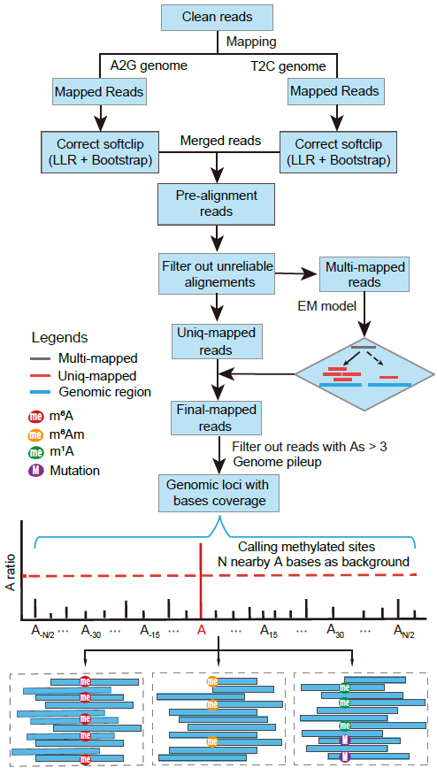

# DeMAP: Deamination-based Methylation Analysis Pipeline

[](https://opensource.org/licenses/MIT)

**DeMAP** is an end-to-end bioinformatics pipeline specifically designed for single-base resolution RNA adenosine methylation data generated by deamination-based sequencing technologies (e.g., GLORI, eTAM-seq, CAM-seq). 

These sequencing methods convert unmethylated adenosines (A) to inosines (I, read as G), while methylated adenosines remain unconverted. DeMAP is optimized to overcome the unique computational bottlenecks of these datasets, including high-frequency non-specific C-to-U mutations and increased multi-mapped reads. Furthermore, DeMAP is capable of simultaneously discriminating **m⁶A, m⁶Am, and m¹A** modifications from a single deamination sequencing dataset.

## 🌟 Key Features
* **Soft-clipping Recovery**: Employs a Log-Likelihood Ratio (LLR) test combined with Parametric Bootstrapping to specifically rescue reads erroneously truncated due to chemical C-to-U side reactions.
* **Multi-mapped Read Allocation**: Utilizes an Expectation-Maximization (EM) algorithm to probabilistically allocate multi-mapped reads, significantly recovering modification signals in homologous and repetitive regions.
* **Multiplexed Modification Discrimination**: Integrates spatial topological features and biochemical signatures (truncation/mismatch rates) to decouple and identify m⁶A, m⁶Am, and m¹A accurately.

## 📊 Pipeline Overview


## 🛠️ Dependencies & Installation

DeMAP is written in Python and operates in a Linux command-line environment. We highly recommend using `conda` to manage dependencies.

**Required Software:**
* STAR (v2.7.5+)
* Bowtie (v1.3+)
* Samtools (v1.15+)

**Required Python Modules (Python 3.8+):**
* `numpy`, `pandas`, `pysam`, `scipy`, `statsmodels`, `Biopython`

### Quick Installation via Conda
```bash
# Create a new conda environment
conda create -n demap_env python=3.8
conda activate demap_env

# Install dependencies
conda install -c bioconda star bowtie samtools pysam
conda install -c conda-forge numpy pandas scipy statsmodels biopython
```

### Download DeMAP

You can acquire DeMAP using either of the following methods:

**Option 1: Direct Download (ZIP)**
You can directly download the repository as a ZIP archive by clicking the **"Code"** green button on this GitHub page and selecting **"Download ZIP"**. 
Once downloaded (typically as `DeMAP-main.zip`), unzip it and navigate into the directory:
```bash
unzip DeMAP-main.zip
cd DeMAP-main
```
**Option 2: Clone via Git**
Alternatively, you can clone the repository using Git:
```bash
git clone https://github.com/ZehongW/DeMAP.git
cd DeMAP
```

## 📂 Data Preparation (Human GRCh38 Example)
**1. Download Reference Genome and Annotation.**
We recommend downloading the primary assembly and GTF from GENCODE:
```bash
wget https://ftp.ebi.ac.uk/pub/databases/gencode/Gencode_human/release_49/GRCh38.primary_assembly.genome.fa.gz
wget https://ftp.ebi.ac.uk/pub/databases/gencode/Gencode_human/release_49/gencode.v49.basic.annotation.gtf.gz
gunzip GRCh38.primary_assembly.genome.fa.gz gencode.v49.basic.annotation.gtf.gz
```

**2.Prepare rRNA Sequences.**
(Note: Human_rRNA.fa file is already included in the DeMAP_v1.0.0 folder. You can skip this step if you are working with human data.)

To manually download and format human rRNA:
```bash
efetch -db nucleotide -id "NR_003287.2,NR_003286.2,NR_003285.2,NR_023363.1" -format fasta > Download_rRNA.fa
sed -e '/5\.8S ribosomal/c\>5.8SrRNA' -e '/18S ribosomal/c\>18SrRNA' -e '/28S ribosomal/c\>28SrRNA' -e '/5S ribosomal/c\>5SrRNA' Download_rRNA.fa > Human_rRNA.fa
```

**3. Build DeMAP Index.**
DeMAP requires a custom index for the A-to-G and T-to-C converted genomes.
```bash
python DeMAP_v1.0.0/build_index.py \
    -g GRCh38.primary_assembly.genome.fa \
    -r Human_rRNA.fa \
    -p 6 \
    -prefix hg38 \
    -o DeMAP_v1.0.0/indexfile
```

**Parameters:**

* `-g`: Reference genome FASTA
* `-r`: rRNA FASTA
* `-p`: Number of threads
* `-prefix`: Prefix for the index files
* `-o`: Output directory for the index files

## 🚀 Quick Start
**Input Requirements:** DeMAP takes pre-processed FASTQ files (adapters and PCR duplicates removed) as input. Currently, only single-end data is supported. Input files in .gz format are supported. 
(Note: Reads should be in the same direction as the sense strand. For stranded libraries like dUTP or SMART methods, usually R2).

**Running DeMAP**: Execute the main program DeMAP_v1.py to complete the entire pipeline: alignment, methylation site calling, and annotation.

```bash
nohup python DeMAP_v1.0.0/DeMAP_v1.py \
    -software DeMAP_v1.0.0 \
    -genomedir DeMAP_v1.0.0/indexfile \
    -fa GRCh38.primary_assembly.genome.fa \
    -gtf gencode.v49.basic.annotation.gtf \
    -q test.fq.gz \
    -pre test_sample \
    -o result_DeMAP \
    -p 8 \
    -m 2 \
    -max 5 \
    -AGcov 15 \
    -Acov 5 \
    -ratio 0.05 \
    -fdr 0.005 > test.log 2>&1 &
```

## Parameters Overview
**Required Parameters:**

| Parameters | Interpretation |
| :---: | :--- |
| -software | Path to the DeMAP_v1.0.0 directory |
| -genomedir | Path to the directory containing genome indices |
| -fa | Path to the reference genome FASTA file |
| -gtf | Path to the gene annotation GTF file |
| -q | Input sequencing data in FASTQ format (.fq or .fq.gz) |
| -pre | Prefix for all output result files |
| -o | Directory where the results will be saved |

**Optional Parameters:**

| Parameters | Interpretation |
| :---: | :--- |
| -p | Number of threads. When set above 20, the EM model may consume up to ~100 GB of memory.|
| -m | Maximum number of allowed mismatches during alignment|
| -max | Max multi-mapped regions allowed for EM model|
| -AGcov | Minimum sequencing coverage (A+G) for calling a site|
| -Acov | Minimum number of unconverted A reads required|
| -ratio | Minimum modification ratio threshold|
| -fdr | Significance threshold (FDR) for methylation calling|

For a complete list of parameters and detailed information, please run:
```bash
python DeMAP_v1.0.0/DeMAP_v1.py --help
```

## 📄 Output Format
The output is a comprehensive table detailing the identified methylation sites.

| Columns | Interpretation |
| :---: | :--- |
| chrome | Chromosome |
| start | Start position |
| end | End position |
| sitename | Unique site name |
| motif | 5-mer motif |
| strand | +/- |
| Acount | A counts (unconverted A reads) |
| AGcount | A + G counts |
| ratio | Unconverted ratio |
| background_ratio | Uackground unconverted ratio |
| methy_level | Modification level |
| TCcount | T + C counts (mismatch) in A position |
| coverage | Total coverage |
| mut_ratio | Mismatch / total coverage |
| A_in_readstart | Number of unconverted A bases located at read start |
| estimated_m6Amlevel | Estimated m6Am modification level (isoform) |
| stop_ratio | Truncation rate: (downstream counts - upstream counts) / downstream counts |
| p_methylation_fdr | FDR adjusted P value for methylation modification |
| p_m6Am_fdr | FDR adjusted P value for m6Am modification |
| p_m1A_fdr | FDR adjusted P value for m1A modification |
| mod_type | Modification type (m6A/m6Am/m1A) |
| disTSS | Distance from site to annotated transcript start site |
| ensg | Ensembl Gene ID |
| gene_name | Gene symbol |
| gene_type | Gene type |
| location | Site location |
| enst | Ensembl Transcript ID |
| transcript_type | Transcript type (Ensembl_canonical/Basic/Others) |


## 📚 Citation
If you use DeMAP in your research, please cite:

[Author Names]. Computational framework for deamination-based RNA adenosine methylation analysis. (Manuscript in preparation)

## 🤝 Maintainers
DeMAP is developed and maintained by Zehong Wu (wuzh93@mail2.sysu.edu.cn).

## 📜 License
DeMAP is released under the MIT License.

We sincerely thank the authors of GLORI-tools for making their source code publicly available, which greatly facilitated the development of our index-building and mapping modules.
